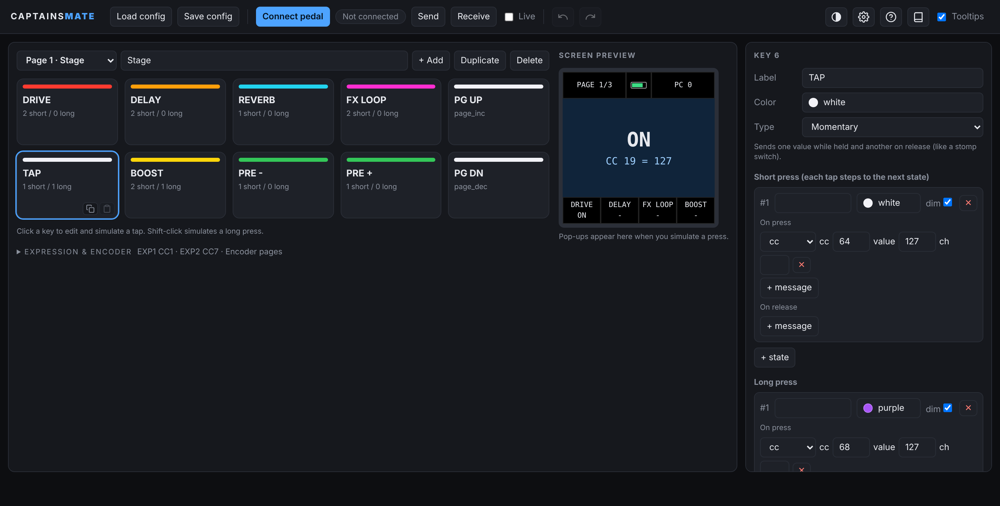

# CaptainsMate

**Edit your MIDI Captain from your browser, press Send, and keep playing.**

**[Try the test emulator in your browser](https://peanutismint.github.io/CaptainsMate/editor/captainsmate.html)**, no pedal or install needed. Build pages, press the keys on screen and watch the pedal's screen preview react. If you do have a pedal, the same page can connect to it over USB (Chrome or Edge).

The MIDI Captain 10 STD is a great little foot controller, but changing what a footswitch does usually means digging through a config file, ejecting the USB drive and rebooting the pedal. CaptainsMate is my attempt to make that painless: a point-and-click editor that runs in your browser, plus a small custom firmware that takes changes live over USB.

It's built for people who just want their pedal to do the right thing on stage, in the studio or at the practice space, without becoming MIDI programmers first.

> Unofficial community project. Not affiliated with or endorsed by Paint Audio or any other brand mentioned here. Use it at your own risk, and keep a backup of your original firmware.

## What you can do with it

- **Design your keys visually.** A 10-key grid, multiple pages, and a live preview of the pedal's screen.
- **Send and receive over USB.** Hit **Send** and the pedal updates instantly and saves. **Receive** pulls the pedal's current setup back into the editor. No ejecting, no rebooting.
- **Give every key a personality.** Momentary, toggle, counter, sequence and page keys, each with its own LED colors.
- **Get a second function for free.** Every key can do one thing on a tap and another on a long press.
- **See what's happening from across the stage.** A big pop-up on the pedal's screen shows the preset number, the counter value or a name like "Chorus" when you press a key.
- **Merge and share pages.** **Import pages** (or just drop a config file onto the editor) lets you tick the pages you want from another config and choose where they go. **Export** saves a single page as a small file to share. A size chip at the top shows how big the config is, and how much memory the pedal has left once connected.
- **Copy, paste, duplicate and undo.** Build one good key or page, then clone it.
- **Light and dark themes,** hover tips on every field, and a built-in MIDI cheat sheet if you're new to all this.

## Quick start

1. Get your pedal running CircuitPython (see [Installing on the pedal](#installing-on-the-pedal)), then copy `firmware/code.py`, `firmware/boot.py` and `firmware/config.json` to its USB drive.
2. Open `editor/captainsmate.html` in Chrome or Edge. It's a single file, there's nothing to install.
3. Click **Connect pedal** and pick the pedal's serial port. The editor reads what's on it.
4. Change something, click **Send**, and step on the key.

Want to see what's possible first? Open `examples/example-config.json` in the editor. It's a three-page setup like a seasoned pedalboard player might build: stage pedals (drive, delay, momentary reverb, FX loop, tap tempo with the tuner on a long press, presets), a looper and scenes page, and an extras page with drum notes, sustain, song select, SysEx master volume and a MIDI panic key. Change the CC numbers to match your own gear. There's also `examples/waza-air-config.json`, a gear-specific example that controls Boss Waza-Air headphones with SysEx (patches, effect on/off, amp knobs), handy as a model for any device that uses SysEx.

## How keys work

Each key has a **type**. Each type can respond to a **tap** and to a **long press** (hold for about half a second, adjustable). Messages can go out when you press down or when you let go.

### Key types, and when to reach for them

| Type | What it does | Great for |
|---|---|---|
| **Momentary** | Sends one value while your foot is down and another when you lift | A reverb swell only while you hold it, a solo boost, a freeze or whammy effect, a sustain pedal |
| **Toggle** | Each tap flips ON and OFF, and the LED changes color | Drive, delay, the FX loop, a compressor, anything you set and forget |
| **Radio (exclusive)** | A pick-one group: pressing a key lights it and dims the others in the same group | Preset or patch banks (8 keys that each recall a patch, only the current one lit), amp or scene selectors |
| **Counter (up / down)** | Steps a value up or down, can wrap around, and can show names on screen | Scene or snapshot select (Verse, Chorus, Solo), amp channel, bank select, volume in steps |
| **Sequence** | Each tap goes to the next state, and each state sends its own messages and shows its own LED color | Clean, Crunch, Lead channel cycling, stepping through delay subdivisions, walking through the parts of a song |
| **Page up / down** | Jumps to the next or previous page of 10 keys | Separate pages for stage, looper and setlist, because ten keys is never enough |

### Taps, long presses and releases in real life

- **Tap** is your everyday action: toggle the effect, go to the next preset.
- **Long press** gives the same key a second job. Tap for tap tempo and hold for the tuner. Tap for the next scene and hold to jump back to scene 1. Tap for undo and hold to clear the loop. Tap to turn boost on and hold to force it off.
- **On press vs. on release** matters more than you'd think. Send on press for instant response, like tap tempo or drum pads. Send on release when you want to avoid accidental double-triggers. Use both together for momentary behavior (127 on press, 0 on release).
- **Many messages on one key** is allowed. One press can change the amp channel, bypass a pedal and recall a preset all at once.

### What a key can send

- **Control Change (CC):** the knobs and switches on most gear, like CC 64 for tap tempo or CC 11 for expression.
- **Program Change (PC)** and **preset up/down:** recall presets or songs.
- **Notes:** trigger drum pads, samplers and synths, with velocity.
- **SysEx:** raw hex messages for device-specific commands that a CC can't reach, like master volume or turning on one particular effect block.
- **Press (macro):** a message that taps, or long-presses, other keys for you. One footswitch can send a CC and also press keys 3 and 4, each moving to its next state as if you'd stepped on it. Handy for scenes that flip several things at once.
- **MIDI channel:** pick a global channel, or override it on any single message so one pedal can drive several devices.

### The rest of the toolbox

- **Pop-up display:** shows a big number or name on the pedal's screen. A zero point can be subtracted, so a counter centered on 64 can read as 0.
- **Encoder wheel:** scroll through pages, or send a CC as you turn it.
- **Expression inputs (EXP1 and EXP2):** send a CC that follows a pedal's position, like wah or volume. They start switched off, so you won't get stray signals.
- **LED feedback:** unlit keys glow dimly in their own color, so you can see at a glance what each key will do. Toggles light up brightly while they're ON and go back to dim when OFF (untick **dim** on any state to keep that key bright after it fires). The idle brightness is adjustable in settings.
- **Screen brightness:** set the pedal screen anywhere from 0 to 100%. For dark stages you can also have it fade down after a few seconds of no activity and snap back to full the moment you press a key or turn the wheel. (This drives the screen's backlight on GP8, taken from the stock firmware, so please report if yours behaves differently.)
- **Battery:** shows the level as voltage, percent or an icon, and can optionally charge rechargeable NiMH batteries (experimental, leave it off with alkaline batteries).

## Installing on the pedal

CaptainsMate's firmware (`firmware/code.py`) runs on **CircuitPython 7.3.1** on the MIDI Captain 10 STD. I can't bundle CircuitPython here: the pedal needs a build made for its own hardware, and it relies on screen and LED drivers that live on the pedal's own drive.

**Where to get things**
- CircuitPython 7.3.1: [the release page](https://github.com/adafruit/circuitpython/releases/tag/7.3.1) and [circuitpython.org/downloads](https://circuitpython.org/downloads). New to CircuitPython? Adafruit's [Welcome to CircuitPython](https://learn.adafruit.com/welcome-to-circuitpython) is a friendly start.
- The [PySwitch project](https://github.com/Tunetown/PySwitch) (and its [fork](https://github.com/danmigdev/PySwitch)) documents how people set up a MIDI Captain, including holding **switch 1** while powering on to mount the USB drive. It's a separate GPL-licensed project, and CaptainsMate doesn't include any of its code.

**Before you change anything**
1. Power the pedal on while holding switch 1 and copy everything from its USB drive (it shows up as MIDICAPTAIN) to a safe folder. That's your backup.
2. Look at what's there. If you see a `code.py`, a `lib` folder and a CircuitPython `boot_out.txt`, your pedal already runs CircuitPython and just needs our three files. If not, your stock firmware may be compiled rather than CircuitPython-based, and you'd need to flash CircuitPython first. That's the advanced, riskier route, so make sure you have your backup and your original firmware file.
3. Copy `code.py`, `boot.py` and `config.json` from the `firmware` folder to the drive, then restart the pedal.

After that first install you rarely need the drive again, because the editor sends updates over USB.

## Tips

- Counters remember their value on the pedal, but the pedal can't read the gear it controls. If you turn a knob on the device itself, the numbers can drift apart. A long press that resets the counter is a handy fix.
- SysEx data is hex bytes, like `F0 7E 7F 06 01 F7`. The pedal adds the `F0` and `F7` for you if you leave them out.
- Web Serial needs Chrome or Edge, and a secure page (a local file or https).
- Something not working? The editor's settings have a **Log** tab that asks the pedal what it's doing.

## Contributing

Bug reports, ideas and pull requests are all welcome. Example configs for specific gear and verified pin or battery details are especially useful. If you'd love to see USB keyboard or mouse keys (to start a DAW from a footswitch, say), open an issue and tell me, it's on the maybe list.

## Credits

Pin map cross-checked against the PySwitch project. Built with help from Claude.

## License

MIT, see [LICENSE](LICENSE).
